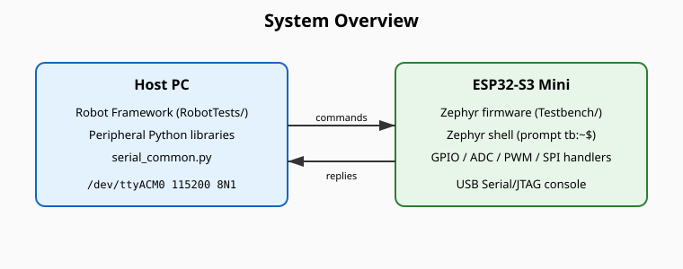
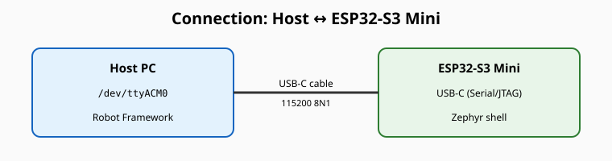

# ITI-Zephyr-Testbench-ESP32S3

Zephyr RTOS testbench running on the **WeAct ESP32-S3 Mini**, validated by
**Robot Framework** tests over USB Serial/JTAG.

## What is this?

The board runs a small Zephyr firmware that exposes hardware peripherals
through a **Zephyr shell** command interface. A Python/Robot Framework
test suite on the host sends commands over the serial port and checks the
replies. This gives automated, repeatable hardware validation.

## System overview



## Connection



- Connect the ESP32-S3 Mini to the host with the USB-C cable.
- The console appears as `/dev/ttyACM0` (Linux) at 115200 baud.
- No extra wiring needed for basic tests; for readback tests wire GPIO7 → GPIO8.

### GPIO loopback (optional, for readback tests)

```
GPIO7 (output)  --->  GPIO8 (input)
```

## Repository layout

```
.
├── Testbench/        Zephyr firmware (shell command interface)
├── RobotTests/       Robot Framework tests
├── docs/             getting started, pin map, command reference
└── README.md
```

## Quick start

1. Build and flash: see `Testbench/README.md`.
2. Run tests: see `RobotTests/README.md`.

## Peripherals

GPIO, UART (console), ADC, PWM, SPI.

## Documentation

- `docs/00_GETTING_STARTED.md`
- `docs/01_DATASHEET.md`
- `docs/02_COMMAND_REFERENCE.md`

## License

MIT
